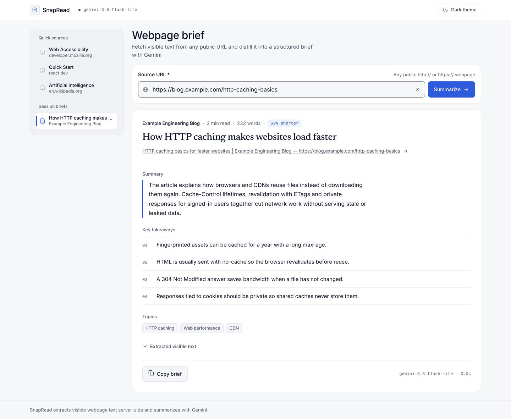
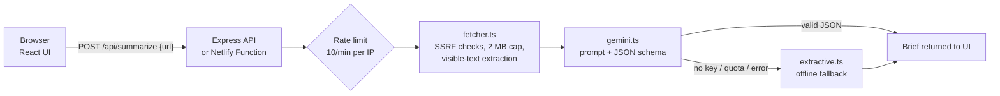
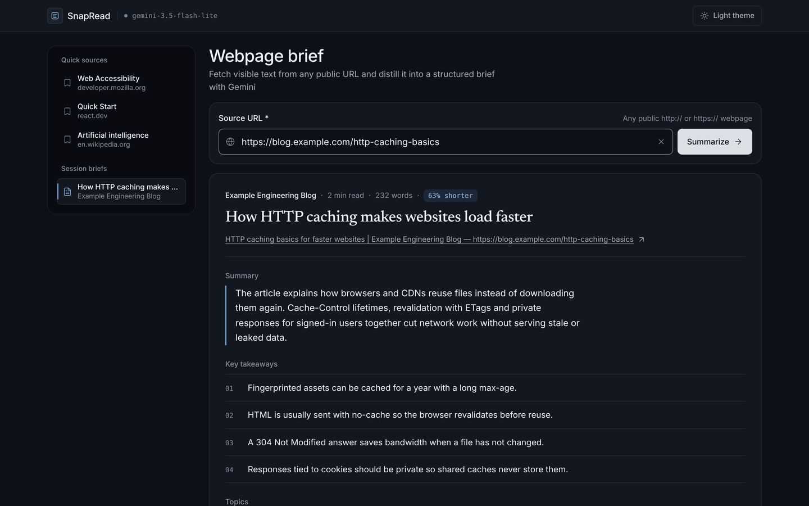
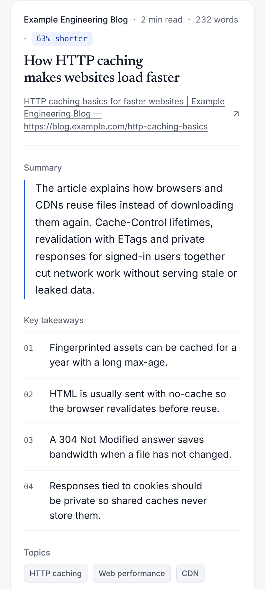

# SnapRead — AI-Driven Website Summariser

Paste any public URL. SnapRead fetches the page on the server, keeps only the text a reader would actually see, and asks **Google Gemini** for a short structured brief: a headline, a 2–4 sentence summary, key takeaways, topic tags and an estimated reading time.

Built for **INT. (Indus Net Technologies) — Angular / React assignment 1: AI-Driven Website Summariser Web App.**

**Live demo:** https://snapread01.netlify.app — no sign-up needed; paste any article URL and press **Summarize**.

**Stack:** React 19 · TypeScript · Vite · Node.js / Express 5 · Google Gemini (`@google/genai`) · cheerio · Netlify Functions · Playwright



---

## Assignment checklist

| Requirement | Where it lives |
| --- | --- |
| Input field for URL | `src/components/UrlForm.tsx` — labelled input, inline validation, `example.com` → `https://example.com`, `/` keyboard shortcut |
| Fetch visible text from the webpage | `server/services/fetcher.ts` — server-side `fetch` + `cheerio`; removes scripts, styles, hidden elements, nav/header/footer; prefers `<main>`/`<article>` |
| Use an AI API to generate a summary | `server/services/gemini.ts` — Gemini `gemini-3.5-flash-lite` with a JSON response schema |
| Display summary neatly | `src/components/SummaryCard.tsx` — headline, summary, numbered takeaways, topic tags, source link, copy button, extracted-text preview |
| Simple loading indicator | `src/components/LoadingCard.tsx` — accessible `<progress>` spinner, skeleton lines and a **Cancel** button |
| React, clean folder structure | `src/` (UI) · `server/` (API) · `netlify/` (serverless) · `tests/` · `e2e/` |
| Basic API handling | `src/services/api.ts` — typed client, `AbortController`, clear messages for 4xx/5xx/429/network errors |
| README with setup steps and how AI was used | This file — see [Setup](#setup) and [How AI is used](#how-ai-is-used) |

## How it works



1. The UI validates the URL and sends it to `POST /api/summarize`.
2. The server checks the URL is public (no `localhost`, private IPs, cloud metadata addresses — checked again after DNS lookup and on every redirect), downloads at most 2 MB and extracts the visible text.
3. The text goes to Gemini with a fixed system instruction and a response schema, so the model must return JSON in the exact shape the UI renders.
4. The JSON is parsed and cleaned on the server before it reaches the browser.
5. If Gemini cannot answer (no key, invalid key, quota used up), SnapRead still returns a brief from its built-in extractive summariser and the card says so.

## How AI is used

| Aspect | Details |
| --- | --- |
| **Feature** | Turns the visible text of a webpage into a headline, a 2–4 sentence summary, 3–5 takeaways, 2–4 topic tags and a reading-time estimate. |
| **Model** | Google Gemini `gemini-3.5-flash-lite` (configurable with `GEMINI_MODEL`). If it fails, SnapRead retries `gemini-3.1-flash-lite`, then `gemini-2.5-flash-lite`. |
| **SDK call** | `@google/genai` → `models.generateContent` with `systemInstruction`, `responseMimeType: "application/json"` and `responseSchema` (structured output). |
| **Prompt** | The system instruction tells the model to summarise only facts in the page and keep it short. The page text is wrapped in `<webpage_content>` tags and the model is told to treat it as untrusted data, never as instructions. `<` and `>` inside the page are escaped so a page cannot close the block early (prompt-injection defence, unit-tested). |
| **Validation** | `parseSummaryPayload()` strips code fences, parses JSON, keeps only non-empty strings, caps takeaways at 5 and topics at 4, and computes reading time from the word count if the model leaves it out. |
| **Fallback** | No key, a rejected key or an exhausted free tier → the offline extractive summariser (`server/services/extractive.ts`) scores sentences by keyword frequency and position. The response carries `meta.provider: "extractive"` and a `notice`, and the UI shows it, so users always know whether Gemini wrote the brief. |
| **Privacy** | Only the page URL, title, description and visible text are sent to Gemini. No user data, cookies or analytics. The API key stays on the server (`.env` / Netlify environment variables) and is never sent to the browser. |
| **Limits** | AI summaries can be incomplete or wrong; pages that need JavaScript to render or block bots return little text; long pages are cut to 24 000 characters (16 000 on Netlify). |

### AI tools during development

AI coding assistants were used for parts of the UI polish, test scaffolding and documentation. Every change was reviewed, run and tested locally before it was committed.

## Setup

**Requirements:** Node.js 20.19+ (22 recommended, see `.nvmrc`) and a free Gemini API key from [Google AI Studio](https://aistudio.google.com/apikey). The app also runs without a key, using the offline summariser.

```bash
git clone https://github.com/durgadas-karmakar07/SnapRead.git
cd SnapRead
npm install

# create your environment file (Windows: copy .env.example .env)
cp .env.example .env
# then open .env and set GEMINI_API_KEY=your_key

npm run dev
```

- App: http://localhost:5173
- API: http://localhost:3001 (Vite proxies `/api` to it)

Production build:

```bash
npm run build
npm start            # serves the built app and API on http://localhost:3001
```

### Environment variables

| Variable | Default | Purpose |
| --- | --- | --- |
| `GEMINI_API_KEY` | — | Gemini key (server only). Without it the offline summariser is used. |
| `GEMINI_MODEL` | `gemini-3.5-flash-lite` | First model to try. |
| `PORT` | `3001` | Express port. |
| `RATE_LIMIT_PER_MINUTE` | `10` | Summaries allowed per client IP per minute. |

## Scripts

| Command | What it does |
| --- | --- |
| `npm run dev` | API (tsx watch) and Vite dev server together |
| `npm run build` / `npm start` | Production build, then serve it with Express |
| `npm run typecheck` | Strict TypeScript for client, server, Netlify functions and E2E tests |
| `npm test` | 55 unit and API tests (Node test runner) |
| `npm run test:coverage` | Same, with a coverage table |
| `npm run e2e:install` then `npm run test:e2e` | Playwright browser tests on desktop and mobile Chromium |
| `npm run check` | Typecheck + tests + build in one go |

## Testing

| Suite | Tool | Result |
| --- | --- | --- |
| Unit + API | Node test runner via `tsx --test` | **55 / 55 passed**, 91.5 % line coverage of `server/` |
| End-to-end | Playwright 1.63 — desktop Chromium + Pixel 7 | **37 passed, 1 skipped** (keyboard shortcut on mobile) |
| Accessibility | axe-core inside Playwright (WCAG 2.1 A/AA) | 0 serious or critical issues |
| Dependencies | `npm audit --omit=dev` | 0 vulnerabilities |

What the tests cover:

- **URL safety:** localhost, private and link-local IPs, decimal/hex IP tricks, IPv4-mapped IPv6, `.local`/`.internal` names, embedded credentials, non-web schemes, DNS answers that point inside the network, redirects to private addresses, redirect loops.
- **Extraction:** hidden elements, scripts and navigation removed; `<main>` preferred; body fallback; 2 MB and 24 000-character limits; plain-text pages; unsupported content types; 403/404 messages; timeouts and cancellation.
- **Gemini integration** (with a fake client): request shape (system instruction, JSON schema, wrapped page text), model fallback order, invalid key stops immediately, quota errors, invalid JSON, cancellation.
- **API:** validation, 413 for oversized bodies, JSON errors for malformed bodies, 429 with `Retry-After`, security headers, fallback notices.
- **Browser (E2E):** loading indicator and cancel, structured brief, history, copy to clipboard, error and retry, rate-limit and offline messages, HTML from the AI rendered as plain text, strict CSP with zero violations, theme toggle, keyboard use.

E2E tests run the **real** Express app, routes and pipeline against the production build. Only the two network calls (fetching the target page and calling Gemini) are replaced with fixtures, so results do not depend on outside websites or API quota. See `e2e/support/mock-server.ts`.

CI (`.github/workflows/ci.yml`) runs typecheck, coverage, build, `npm audit` and the E2E suite on every push.

## API

### `GET /api/health`

```json
{ "ok": true, "aiConfigured": true, "model": "gemini-3.5-flash-lite" }
```

### `POST /api/summarize`

Request: `{ "url": "https://example.com/article" }` (optional header `X-Gemini-Api-Key` lets a user try their own key for one browser session).

Response `200`:

```json
{
  "page": { "url": "...", "title": "...", "siteName": "...", "wordCount": 1640, "truncated": false, "excerpt": "..." },
  "summary": { "headline": "...", "summary": "...", "keyPoints": ["..."], "topics": ["..."], "readingTimeMinutes": 7 },
  "meta": { "model": "gemini-3.5-flash-lite", "provider": "gemini", "durationMs": 1850 }
}
```

Errors always use `{ "error": { "code": "...", "message": "..." } }`:

| Status | Codes |
| --- | --- |
| 400 | `INVALID_URL`, `UNSUPPORTED_PROTOCOL`, `PRIVATE_URL_BLOCKED`, `INVALID_JSON` |
| 413 | `PAGE_TOO_LARGE`, `PAYLOAD_TOO_LARGE` |
| 415 | `UNSUPPORTED_CONTENT_TYPE` |
| 422 | `DNS_LOOKUP_FAILED`, `EMPTY_CONTENT` |
| 429 | `RATE_LIMITED` (with `Retry-After`) |
| 502 / 504 | `UPSTREAM_HTTP_ERROR`, `FETCH_FAILED`, `TOO_MANY_REDIRECTS`, `FETCH_TIMEOUT` |

## Security

- **SSRF protection** on the user-supplied URL: scheme allow-list, private/reserved IP blocking, DNS check before every request, manual redirect handling (max 5) with the same checks on each hop.
- **Resource limits:** 16 KB request bodies, 2 MB page downloads, 12 s fetch timeout (5.5 s on Netlify), per-IP rate limit.
- **Security headers** on every response (Express and `netlify.toml`): strict Content-Security-Policy with no inline scripts or styles, `frame-ancestors 'none'`, `nosniff`, `Referrer-Policy`, `Permissions-Policy`, `COOP`.
- **Output safety:** AI text is rendered by React as plain text; there is no `dangerouslySetInnerHTML` anywhere.
- **Secrets:** the Gemini key lives only in server environment variables; `.env` is git-ignored.

## Deploying to Netlify

The live demo at https://snapread01.netlify.app is deployed this way.

`netlify.toml` builds the app, publishes `dist/`, maps `/api/health` and `/api/summarize` to the functions in `netlify/functions/` and sets the security headers.

1. Push the repository to GitHub (never commit `.env`).
2. In Netlify, import the repository — build settings are read from `netlify.toml`.
3. Under **Project configuration → Environment variables** add `GEMINI_API_KEY` (and optionally `GEMINI_MODEL`).
4. Deploy.

## Project structure

```text
SnapRead/
├── src/                       React + TypeScript UI
│   ├── App.tsx                App state: request, loading, errors, history, theme
│   ├── components/            Header, Sidebar, UrlForm, LoadingCard, SummaryCard, ErrorBanner, CopyButton
│   ├── services/api.ts        Typed API client with cancellation and error mapping
│   ├── data/sampleBrief.ts    Sample brief shown before the first request, quick sources
│   └── types/summary.ts       Shared response types
├── server/                    Express API
│   ├── index.ts               App factory: security headers, JSON body limit, static files, JSON errors
│   ├── config.ts              Environment and limits
│   ├── routes/summarize.ts    GET /api/health, POST /api/summarize
│   └── services/
│       ├── fetcher.ts         SSRF-safe fetch and visible-text extraction
│       ├── gemini.ts          Prompt, response schema, model fallback, JSON parsing
│       ├── extractive.ts      Offline extractive summariser
│       ├── pipeline.ts        Shared fetch → summarise flow (Express and Netlify)
│       ├── rateLimit.ts       Per-IP fixed-window limiter
│       └── securityHeaders.ts CSP and other headers
├── netlify/functions/         Serverless versions of the two endpoints
├── tests/                     Unit and API tests (55)
├── e2e/                       Playwright tests and the fixture server
├── docs/screenshots/          Images used in this README
└── .github/workflows/ci.yml   Continuous integration
```

## Design decisions

- **Fetch on the server, not in the browser.** Browsers block cross-origin page reads (CORS), and the API key must stay secret, so a small backend is required.
- **Structured output instead of free text.** A response schema means the UI can render each part of the brief reliably, and bad output is rejected before it reaches the user.
- **One pipeline, two hosts.** `pipeline.ts` is shared by Express (local and any Node host) and Netlify Functions, so behaviour is identical everywhere.
- **Always return something useful.** The offline summariser keeps the app working without a key or when the free tier runs out, and the UI is honest about which engine answered.
- **Accessible by default.** Native form validation hooks, `aria-invalid`, live regions for status and copy feedback, a skip link, visible focus, reduced-motion support and light/dark themes. Checked with axe-core in the E2E suite.

## Screenshots

| Dark theme | Mobile |
| --- | --- |
|  |  |

Screenshots were captured from the production build using the E2E fixture article, so they are reproducible without an API key.

## Future work

- Stream the summary token by token for faster first paint.
- Summary length and language options.
- Render JavaScript-heavy pages with a headless browser when plain HTML has too little text.
- Shared rate-limit store (Redis/Upstash) for multi-instance deployments.

---

**Author:** Durga Das Karmakar · B.Tech (IT), Bengal College of Engineering & Technology · [GitHub](https://github.com/durgadas-karmakar07) · [LinkedIn](https://www.linkedin.com/in/durgadas-karmakar-60ab70429)
